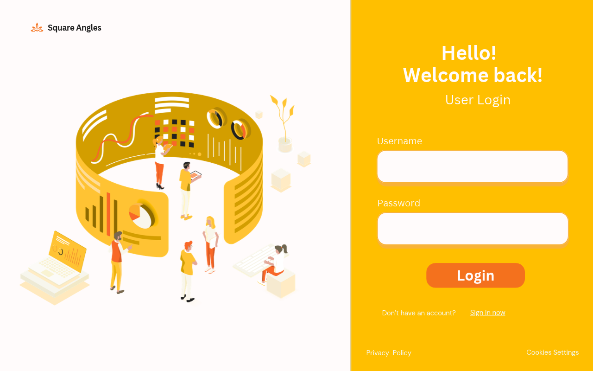

# 3. Getting Started

## 3.1 Accessing the Application

1. Open a supported web browser.
2. Navigate to the BOMS application URL.
3. Wait for the login page to display.

## 3.2 Logging In

1. Enter your assigned username.
2. Enter your password.
3. Select the **Sign In** button.
4. Wait for the dashboard to display.

## 3.3 Logging Out

1. Navigate to your user profile.
2. Select **Log Out**.
3. Confirm that the login page appears.

## 3.4 Forgot Password

1. Navigate to the login page.
2. Select **Forgot Password**.
3. Follow the password reset instructions.

**Note:** Contact your system administrator
if you cannot reset your password.

