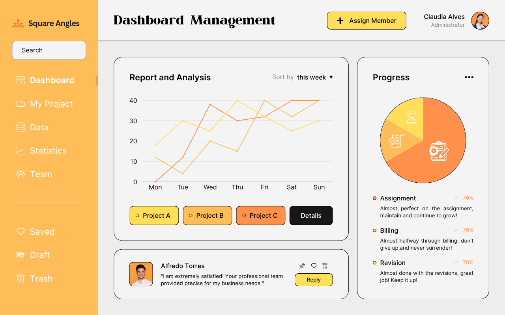

# 4. Dashboard Navigation

## 4.1 Overview

The dashboard provides access to the primary
features of the BOMS application.

## 4.2 Dashboard Components

| Component | Description |
|---|---|
| Dashboard | Displays business activity |
| Employees | Opens employee records |
| Departments | Opens department records |
| Projects | Displays project information |
| Reports | Provides reporting options |
| User Profile | Displays account settings |

## 4.3 Accessing Application Modules

1. Log in to BOMS.
2. Locate the navigation menu.
3. Select the module you want to access.
4. Wait for the selected module to display.

**Expected Result:** The selected module opens.

